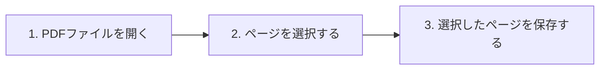

# 使い方 (Usage)

PDF Page Splitter の基本的な使用方法と、各機能の詳細について説明します。

---

## 基本的な操作手順

本アプリケーションの操作は以下のシンプルな3ステップで完了します。

### ステップ 1: PDFファイルを開く
1. 画面左上の **「PDFを開く」** ボタンをクリックします。
2. ファイルダイアログが表示されるので、分割したいPDFファイルを選択します。
3. 読み込みが開始されると、ページカードの枠組み（プレースホルダー）が即座に表示されます。
4. バックグラウンドスレッドで自動的にサムネイルが生成され、順次表示されます。
   - ※ 読み込み中も、すでに読み込まれたページの選択やスクロールなどの操作が可能です。

### ステップ 2: ページを選択する
1. 抽出したいページのサムネイルカードをクリックします。
   - 選択されたカードは **赤枠でハイライト** され、文字色も赤に変わります。
   - 再度クリックすると、選択が解除されます。
2. 画面右上にあるコントロールボタンを使用して、まとめて選択することも可能です。
   - **「すべて選択」**: PDF内の全ページを選択状態にします。
   - **「選択解除」**: すべてのページの選択を解除します。

### ステップ 3: 選択したページを保存する
1. ページが1枚以上選択されると、画面左上の **「選択したページを保存」** ボタンが有効（緑色）になります。
2. **「選択したページを保存」** ボタンをクリックします。
3. 保存先を指定するファイルダイアログが表示されるので、任意の保存場所とファイル名（拡張子は `.pdf`）を入力し、保存します。
4. 保存処理が成功すると、完了ダイアログが表示されます。
   - 選択されたページのみが、**元のPDFでのページ順（昇順）に結合** された新しいPDFファイルとして保存されます。

---

## 画面構成とUI要素の解説

### 1. ヘッダーエリア（上部操作パネル）
* **「PDFを開く」ボタン（青）**: 新しいPDFファイルを読み込みます。
* **「選択したページを保存」ボタン（グレー／緑）**: ページ未選択時は無効化（グレー）されており、1ページ以上選択されると有効化（緑）されます。
* **「すべて選択」ボタン（グレー）**: PDFを開くと有効化され、ワンクリックで全ページを選択できます。
* **「選択解除」ボタン（グレー）**: PDFを開くと有効化され、ワンクリックで選択を一括解除できます。

### 2. プレビューエリア（中央グリッド表示）
* **レスポンシブ配置**: ウィンドウの幅に応じて、1行に表示されるサムネイルの数が自動的に調整されます。
* **スクロール操作**: マウスホイールによる滑らかなスクロールに対応しています。

### 3. ステータスバー（下部情報パネル）
* 現在読み込んでいるファイルの名前や、総ページ数、選択されているページ数がリアルタイムで表示されます。
  - 例: `選択中: 3 / 10 ページ | ファイル: document.pdf`
